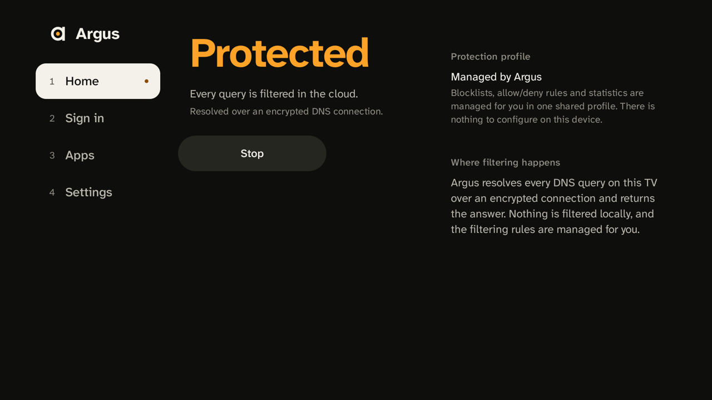
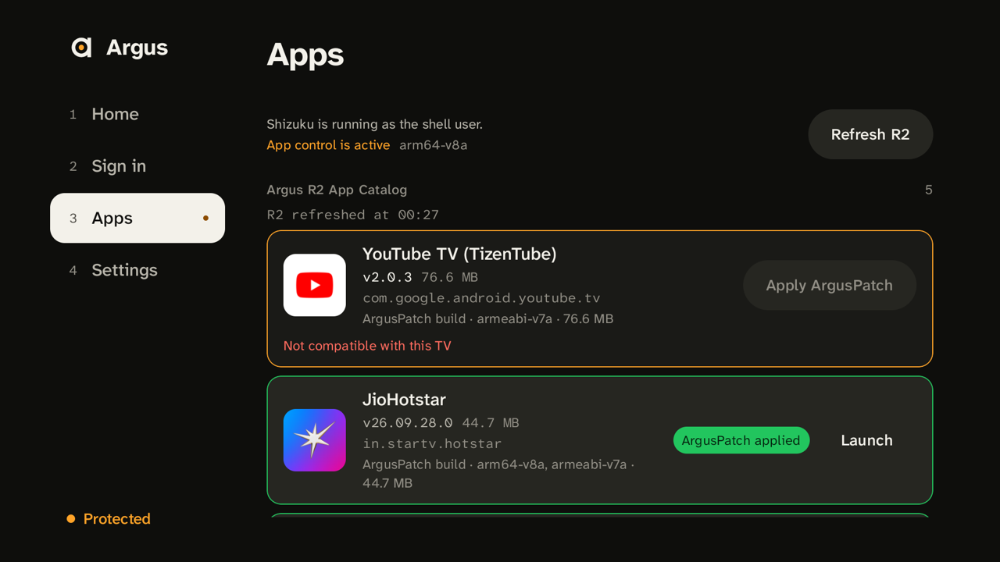
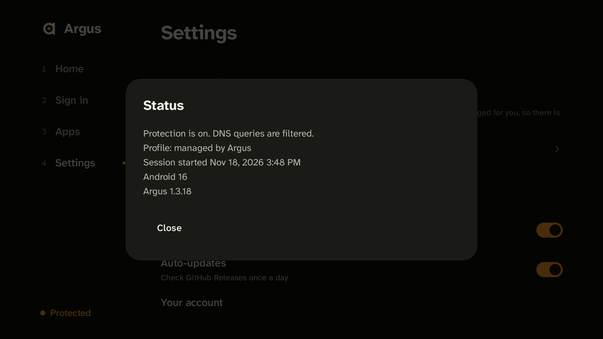

<div align="center">
  
  <p>Root-free, system-wide ad blocking for Android TV.</p>
  <p>
    <a href="https://github.com/0xargusapp/Argus-TV/releases"></a>
    <a href="https://github.com/0xargusapp/Argus-TV/releases"></a>
    <a href="#requirements"></a>
    <a href="#requirements"></a>
    <a href="#license-and-contact"></a>
  </p>
</div>

Blocks ads and trackers at the DNS layer across every app on Android TV,
Google TV, and Fire TV, as well as Android phones. Every query goes over
DNS-over-HTTPS (DoH) to a managed profile, so nothing is filtered on the
device and no blocklist or query history lives on your TV. It runs on the TV
you already own without root, an account, a subscription, or a computer, and
installs straight from your remote.

## Download

[](https://github.com/0xargusapp/Argus-TV/releases/download/latest/argus.apk) [](https://github.com/0xargusapp/Argus-TV/releases/latest) **~2.8 MB** universal APK

SHA-256: [`argus.apk.sha256`](https://github.com/0xargusapp/Argus-TV/releases/download/latest/argus.apk.sha256) · Live version, byte size, and steps at [argus-alpha-dusky.vercel.app/download](https://argus-alpha-dusky.vercel.app/download)

### Downloader (no computer)

1. Install **Downloader by AFTVnews** from your TV's app store.
2. On Google TV and Android TV 12 or newer, enable Developer Options: open
   **Settings** → **System** → **About** and click **Android TV OS build**
   seven times.
3. Open Downloader and enter `github.com/0xargusapp/Argus-TV/releases/download/latest/argus.apk`
   (or the shorter redirect `0xargusapp.github.io/Argus-TV`).
4. Allow Downloader to **Install unknown apps** when prompted, then install.
5. Open Argus, press **Start**, and approve the single VPN permission prompt.

> [!NOTE]
> Enable **Always-on VPN** for Argus in system network settings if your
> firmware exposes it so protection resumes immediately after a reboot.

### Obtainium (updates itself)

1. Open [Obtainium](https://github.com/ImranR98/Obtainium) and tap **Add App**.
2. Paste `https://github.com/0xargusapp/Argus-TV`, set **APK filter** to
   `argus\.apk$`, and tap **Add**.

### adb (from a computer)

```bash
adb connect <tv-ip>:5555
adb install -r argus.apk
```

Enable **ADB debugging** (or **Wireless debugging**) under Developer Options on
the TV first.

### Verify what you installed

```bash
sha256sum argus.apk     # Linux
shasum -a 256 argus.apk # macOS
```

Compare the hash against [`argus.apk.sha256`](https://github.com/0xargusapp/Argus-TV/releases/download/latest/argus.apk.sha256)
on the [latest release](https://github.com/0xargusapp/Argus-TV/releases/latest)
or on [argus-alpha-dusky.vercel.app/download](https://argus-alpha-dusky.vercel.app/download).
Because sideloaded APKs bypass store review, checking the digest confirms your
file matches the CI build. Every build is signed with the same certificate
(`CN=Argus, OU=TV, O=NexusBlock, C=IN`), so updates install over the top.

## Screenshots





- **Home:** Protection status, Start/Stop toggle, and managed profile readout.
- **Apps:** Bundled Shizuku control state and verified catalog of TV builds.
- **Settings:** Session status, auto-start on boot, and GitHub self-updater.

## What it does

- **Zero local filtering.** Every DNS query forwards over DoH to a managed
  profile, keeping the APK at ~2.8 MB with no local blocklist or query history.
- **Resolver capture.** Public resolvers including `8.8.8.8` and `1.1.1.1` route
  into the tunnel so apps with hardcoded DNS or direct DoH cannot bypass it.
- **Fails closed.** If no profile is available or the APK fails its release
  signature pin, the VPN service refuses to start rather than leak unfiltered DNS.
- **Boot and crash recovery.** Restores protection after reboots or updates when
  enabled, backed by a 15-minute WorkManager watchdog and crash recovery hook.
- **In-app updates.** Checks GitHub Releases via ETag conditional requests and
  verifies SHA-256 plus signing-certificate equality before prompting.
- **Root-free app control.** Uses a bundled Shizuku service over Wireless
  debugging or ADB to disable or re-enable installed bloatware from the TV.
- **Verified app catalog.** Installs curated APKs or swaps eligible streaming
  apps for patched builds after verifying manifest signature, SHA-256, and key.

## How it works

```text
Apps on the TV
      |  UDP :53 queries + hardcoded resolver traffic (8.8.8.8, 1.1.1.1, ...)
      v
VpnService TUN (10.10.10.1 / fd00::1:c0de, DNS-only, no default route)
      |
      v
DnsTunnelLoop (reader/writer threads on TUN fd, IPv4/IPv6 UDP:53 codec)
      |
      v
DnsForwarder (OkHttp DoH POST application/dns-message, excluded from TUN)
      |
      v
Managed NextDNS profile (dns.nextdns.io/<id>)
```

- **No local filtering:** Argus ships no rule engine, domain database, or local
  counters. Blocklists and allow/deny rules live on the managed profile.
- **Resolver capture:** `/32` and `/128` host routes for Cloudflare, Google,
  ControlD, NextDNS, CIRA, DNS.SB, and legacy Level3/CenturyLink resolvers
  capture all ports on those IPs, dropping direct DoH/DoT so apps fall back to
  the tunnel without touching ordinary traffic.
- **Fails closed:** `NexusVpnService` verifies the release certificate pin and
  confirms a valid profile ID is stored before calling `Builder.establish()`.
- **What Argus never sees:** Video streams, HTTPS payloads, and credentials
  bypass the TUN entirely. Because DNS filtering cannot inspect TLS traffic,
  first-party ads served from the same host as video are outside DNS reach.

<details>
<summary>Under the hood: packet path, identity, and catalog verification</summary>

1. **Packet handling:** `DnsTunnelLoop` splits TUN reads (`Os.poll` +
   `Os.read`) from response writes so replies return immediately. `DnsForwarder`
   caps concurrent DoH calls at 32, emits `SERVFAIL` on failure, and excludes
   Argus via `addDisallowedApplication` so its own DoH traffic never loops.
2. **Identity:** Optional QR or tag + PIN sign-in encrypts tokens with
   AES-256-GCM in the Android Keystore and proves device identity with a
   non-exportable Keystore ECDSA P-256 key (StrongBox when supported).
3. **Catalog safety:** `catalog.json` verifies against a compiled-in ECDSA
   P-256 public key (`catalog.json.sig`) before parsing. `ArgusPatchInstaller`
   checks SHA-256, package ID, compiled-in signer allowlist, and entry signer
   pin, and backs up split APKs via `pm path` for `pm install-multiple` restore.
4. **YouTube limits:** DNS YouTube blocking uses NextDNS's geo-proxy beta, which
   can affect YouTube Music, YouTube TV, or region-locked streams; the catalog
   separately offers a patched YouTube TV build (`TizenTube`) on compatible ABIs.

</details>

## Requirements

- **Minimum OS:** Android 7.0 (API 24) or newer; compiled against SDK 36.
- **Devices:** Android TV, Google TV, Fire TV, and Android phones or tablets.
- **Package:** One universal APK (`arm64-v8a`, `armeabi-v7a`, `x86`, `x86_64`),
  ~2.8 MB.
- **Will not work:** Devices under Android 7.0; running alongside a second VPN
  (Android permits one `VpnService`); and same-package patches over preinstalled
  system apps. Android TV 11+ also resets Wireless debugging across reboots, so
  Shizuku app control needs Wireless debugging toggled back on after restart.

## FAQ

### Does this need root?
No. DNS filtering uses Android's standard `VpnService`, and **Apps** control
runs Argus's bundled Shizuku service over Wireless debugging or ADB.

### Will my TV's other apps still work?
Yes. Argus adds no default route to the VPN, so only DNS queries and captured
resolver IPs enter the tunnel while all other traffic flows normally.

### Does it slow the TV down or drain the battery?
No local rule engine or packet proxy runs in the background, and media streams
bypass the TUN completely. Only DNS lookups cross the forwarder.

### Where do the blocklists come from, and can I change them?
Nothing is filtered on the device; the profile is managed for you on NextDNS and
you cannot edit it. Rule updates apply automatically without a new APK.

### Is my browsing history logged anywhere, and by whom?
Argus stores no query logs, domain lists, or counters locally. DNS queries go to
the managed NextDNS profile, retaining only what that profile configures.

### Why is it not on the Play Store?
Google Play and the Amazon Appstore forbid `VpnService` apps that filter ads
across other apps. Distributing signed APKs here keeps system-wide blocking
and in-app updates intact.

### Does it work on a phone?
Yes. The same universal APK switches to a bottom bar on portrait phones and
provides a **Quick Settings** tile (`Ad Block`) to toggle protection.

### What happens if I remove the companion account?
Nothing changes for ad blocking. Protection runs signed out, stays active
offline with the cached profile, and keeps working after account deletion.

### Why does my TV warn about a VPN?
Android shows a one-time consent dialog and an active status icon for every
local `VpnService`. Argus uses it only for DNS capture, not remote routing.

### Will this break a streaming app?
Most apps keep playing while ad and tracker hosts are blocked. First-party ads
served from playback domains and NextDNS's YouTube beta limits can still show
ads or break YouTube Music, YouTube TV, or region-locked videos.

## Security

- **Signature pinning:** `TamperGuard` verifies the release certificate SHA-256
  at tunnel startup and fails closed on repackaged builds.
- **Encrypted DNS:** Queries leave the device as DoH HTTPS POST payloads, never
  cleartext UDP port 53.
- **Keystore auth:** Optional session tokens use Keystore AES-256-GCM, and
  device challenges sign with a hardware-backed ECDSA P-256 key when available.
- **Catalog and update checks:** Self-updates require matching SHA-256 and
  signing certificate; catalog installs verify manifest signature, SHA-256, and
  pinned signer keys before modifying any app.
- **No local query storage:** No query log or browsing history is saved on disk.
- **Out of scope:** First-party ads inside encrypted TLS video streams, traffic
  while another VPN replaces Argus, or compromised device trust anchors.

See [`SECURITY.md`](SECURITY.md) for vulnerability reporting and scope.

## Project status

This public repository holds signed APKs, checksums, release notes, and
documentation while the source code stays in a private repository. Builds ship
to [Releases](https://github.com/0xargusapp/Argus-TV/releases) as fixes and
catalog updates land; report bugs to **argusapp@proton.me**.

## License and contact

Proprietary software. All rights reserved.
Bugs, ban appeals, security reports, and press: **argusapp@proton.me**.

[docs/index.html](https://0xargusapp.github.io/Argus-TV/) · [Download page](https://argus-alpha-dusky.vercel.app/download) · [Releases](https://github.com/0xargusapp/Argus-TV/releases)
